# Bộ sơ đồ Use Case, Activity và Sequence

Các sơ đồ dưới đây mô tả 5 chức năng theo phân công thành viên. “User diagram” được hiểu là **Use Case diagram**. Use Case và Activity được biểu diễn bằng Mermaid `flowchart`; Sequence dùng Mermaid `sequenceDiagram`.

## TV1 — Tín Phát: Tạo lịch trình du lịch tự động bằng Gemini AI

### Use Case diagram

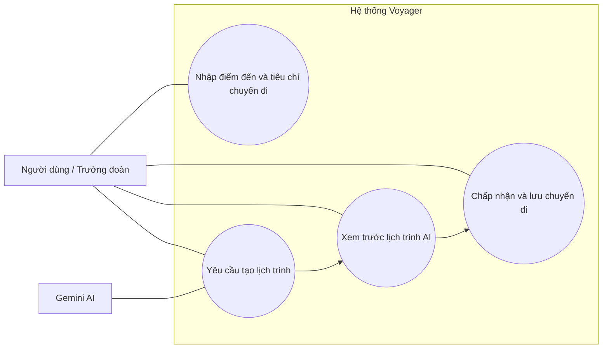

### Activity diagram

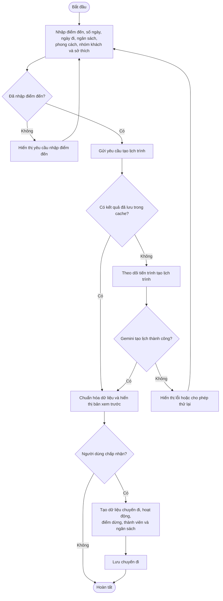

### Sequence diagram

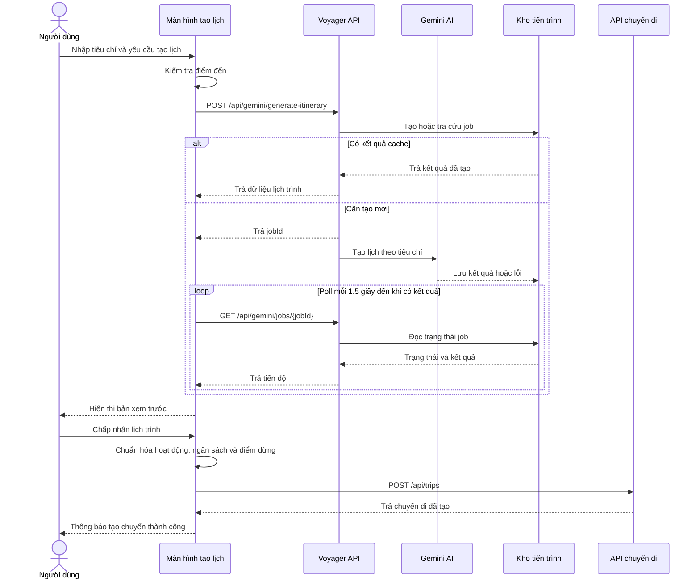

## TV2 — Phạm Huy: Tối ưu lịch trình bằng AI theo yêu cầu

### Use Case diagram

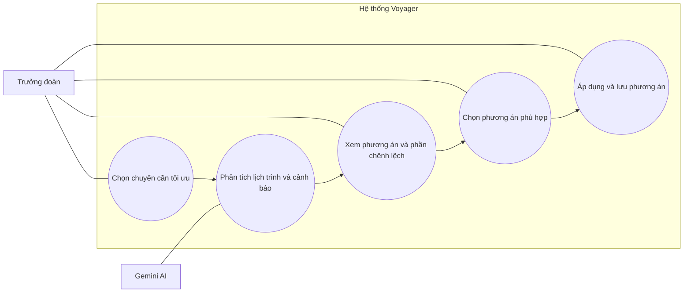

### Activity diagram

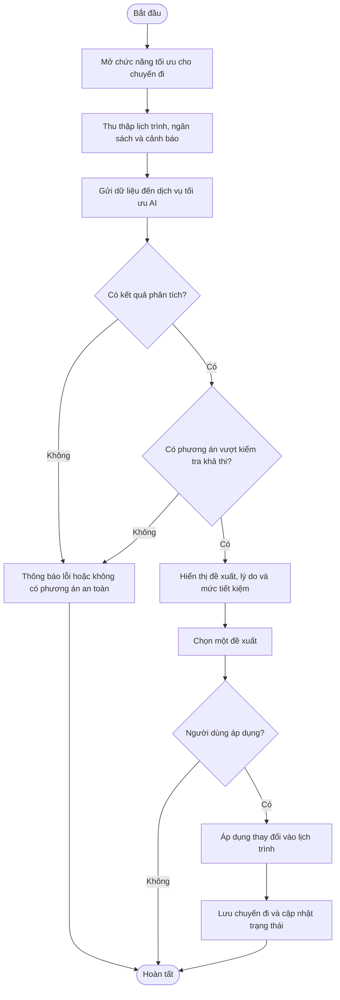

### Sequence diagram

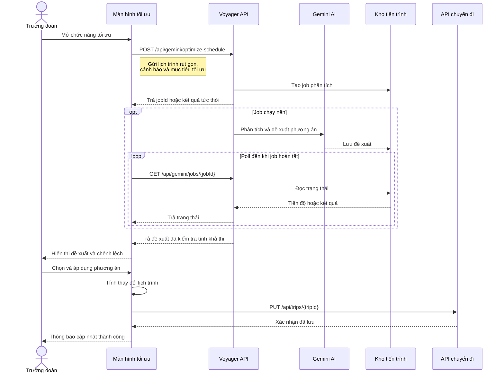

## TV3 — Gia Khánh: Quản lý bản đồ và tiến độ lịch trình

### Use Case diagram

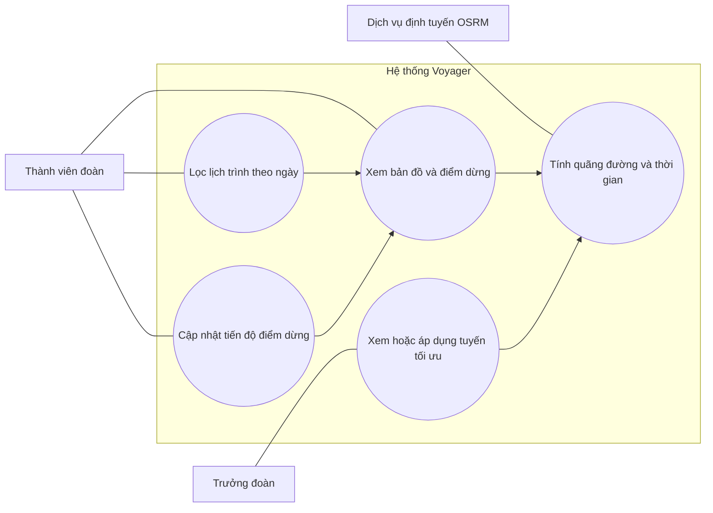

### Activity diagram

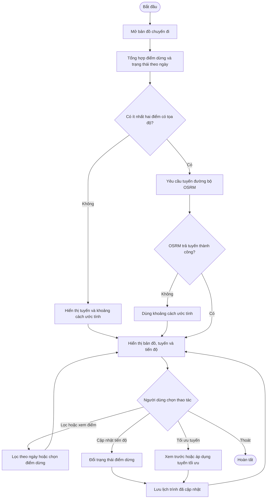

### Sequence diagram

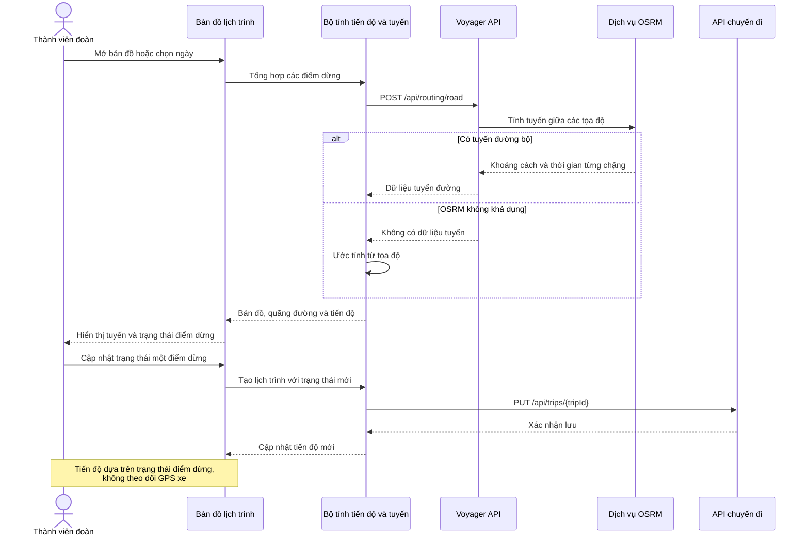

## TV4 — Quốc Tuấn: Quản lý thành viên và điểm danh đoàn du lịch

### Use Case diagram

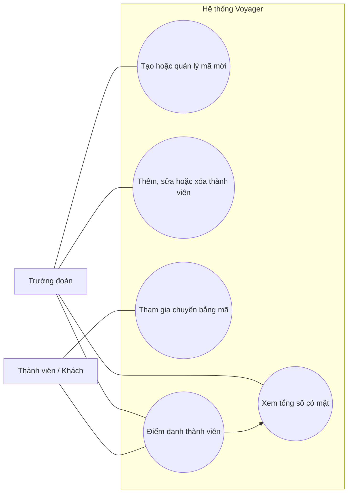

### Activity diagram

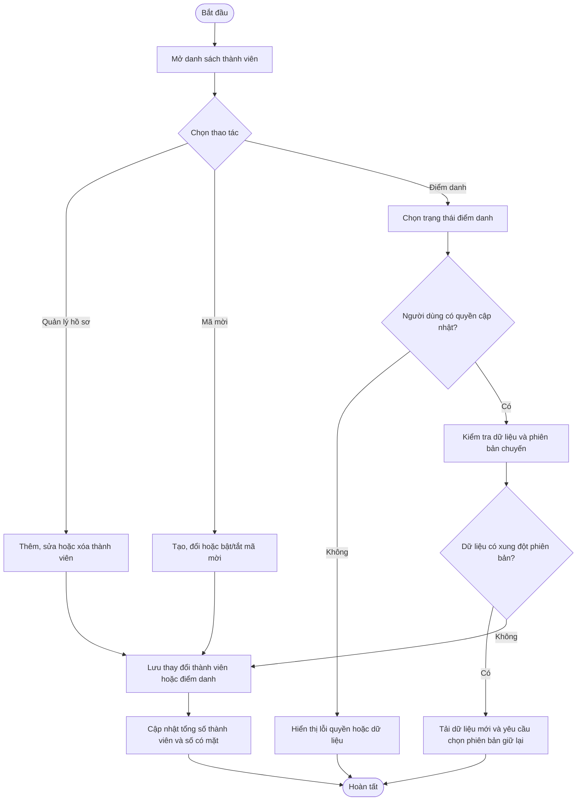

### Sequence diagram

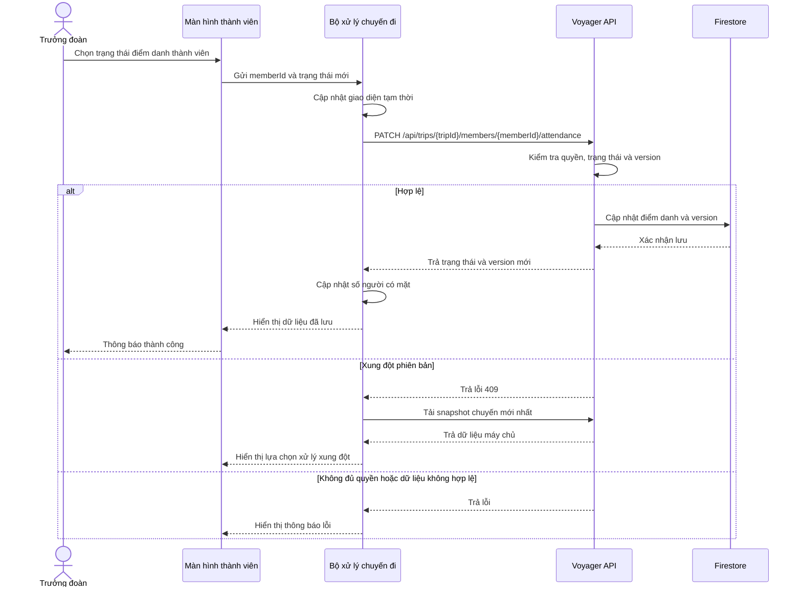

## TV5 — Minh Tuấn: Quản lý ngân sách và ghi nhận hóa đơn chuyến đi

### Use Case diagram

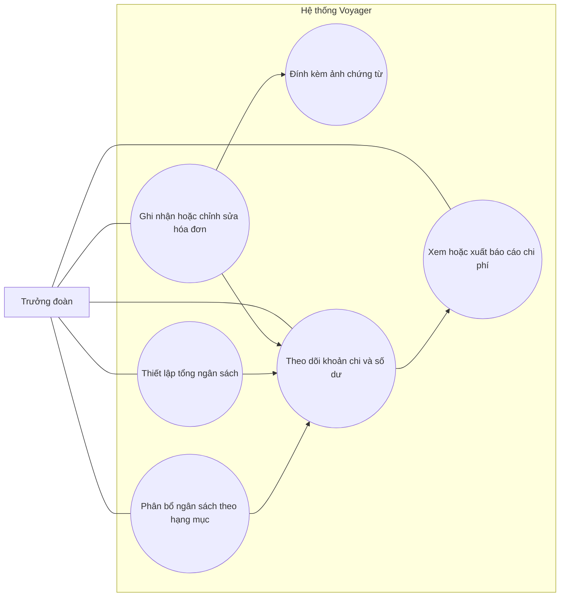

### Activity diagram

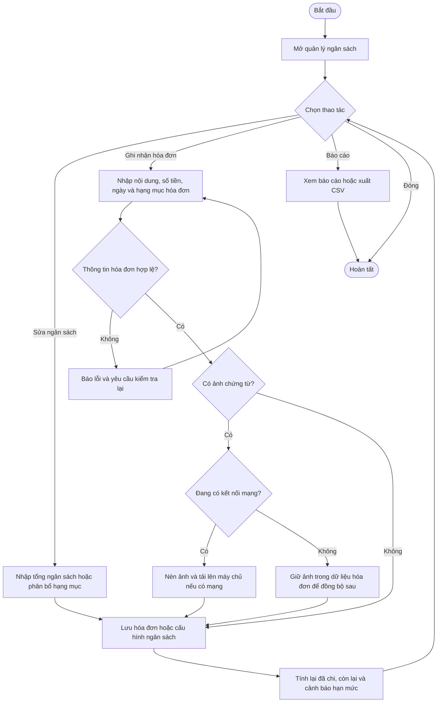

### Sequence diagram

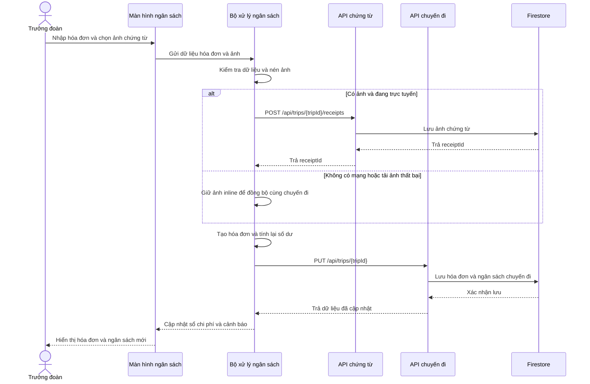
