# Đặc tả Use Case, Activity Diagram và Sequence Diagram — Hệ thống Voyager

Tài liệu tổng hợp **5 Đặc tả Use Case** (kèm Use Case Diagram), **5 Activity Diagram** và **5 Sequence Diagram** cho 5 chức năng cốt lõi dựa trên mã nguồn thực tế của dự án **Voyager**.

---

## Mục lục

1. [TV1 — Tín Phát: Tạo lịch trình du lịch tự động bằng Gemini AI](#1-tv1--tín-phát-tạo-lịch-trình-du-lịch-tự-động-bằng-gemini-ai)
2. [TV2 — Phạm Huy: Tối ưu lịch trình bằng AI (theo yêu cầu)](#2-tv2--phạm-huy-tối-ưu-lịch-trình-bằng-ai-theo-yêu-cầu)
3. [TV3 — Gia Khánh: Quản lý bản đồ và tiến độ lịch trình](#3-tv3--gia-khánh-quản-lý-bản-đồ-và-tiến-độ-lịch-trình)
4. [TV4 — Quốc Tuấn: Quản lý thành viên & Điểm danh đoàn du lịch](#4-tv4--quốc-tuấn-quản-lý-thành-viên--điểm-danh-đoàn-du-lịch)
5. [TV5 — Minh Tuấn: Quản lý ngân sách & Ghi nhận hóa đơn chuyến đi](#5-tv5--minh-tuấn-quản-lý-ngân-sách--ghi-nhận-hóa-đơn-chuyến-đi)

---

## 1. TV1 — Tín Phát: Tạo lịch trình du lịch tự động bằng Gemini AI

### 1.1. Đặc tả Use Case (Use Case Specification)

| Thuộc tính | Nội dung chi tiết |
| :--- | :--- |
| **Mã Use Case** | `UC-01` |
| **Tên Use Case** | Tạo lịch trình du lịch tự động bằng Gemini AI |
| **Người phụ trách** | TV1 — Tín Phát |
| **Tác nhân chính** | Người dùng đã đăng nhập / Trưởng đoàn (`User`, `Admin`) |
| **Tác nhân phụ** | Gemini AI (`@google/genai`), Firestore / Bộ nhớ máy chủ |
| **Mô tả tóm tắt** | Cho phép người dùng nhập điểm đến và các tiêu chí chuyến đi (số ngày, ngày khởi hành, ngân sách, phong cách, nhóm khách, sở thích), hệ thống gọi Gemini AI sinh lịch trình JSON có cấu trúc, chuẩn hóa tọa độ/ngân sách/cảnh báo, hiển thị bản xem trước và lưu thành chuyến đi mới. |
| **Tiền điều kiện** | - Người dùng đã đăng nhập hợp lệ (có Firebase ID Token). - Máy chủ có `GEMINI_API_KEY` khả dụng. - Người dùng chưa vượt giới hạn `10 request / 5 phút` và chưa có quá `2` tác vụ AI đang chạy đồng thời. |
| **Hậu điều kiện** | - Nếu người dùng chấp nhận lưu: Chuyến đi mới được tạo trong hệ thống (`POST /api/trips`, `version = 1`), cấp `joinCode` duy nhất và đồng bộ lên danh sách chuyến đi đang hoạt động. - Nếu hủy: Không lưu dữ liệu chuyến đi mới. |
| **Luồng sự kiện chính (Main Flow)** | 1. Người dùng mở hộp thoại Lập kế hoạch chuyến đi (`TripPlannerModal`) và chọn tab AI (`AiPlannerTab`). 2. Người dùng nhập: Điểm đến (có gợi ý địa danh), Số ngày (`2–7`), Ngày đi, Ngân sách, Phong cách, Nhóm khách và Sở thích. 3. Người dùng nhấn nút **"Tạo lịch trình bằng Gemini AI"** (`handleGenerateAI`). 4. Client kiểm tra đã nhập điểm đến, gửi `POST /api/gemini/generate-itinerary`. 5. Server xác thực token (`requireAuth`), kiểm tra rate limit (`aiRateLimiter`), kiểm tra số ngày `2–7` và tra cứu cache (`getCachedGeminiResult`). 6. Nếu chưa có cache, server đặt 1 slot xử lý (`gemini_job_slots`), tạo bản ghi tiến trình (`gemini_jobs`), trả về `202 Accepted` kèm `jobId`. 7. Server chạy bất đồng bộ gọi Gemini API (`generate-itinerary`), parse và sửa JSON (`parseGeminiJson`), kiểm tra đủ số ngày và mỗi ngày có `1–3` hoạt động. 8. Client polling `GET /api/gemini/jobs/{jobId}` mỗi `1.5 giây` (tối đa `90 giây`) cho đến khi `status === 'completed'`. 9. Client hiển thị bản xem trước lịch trình AI. 10. Người dùng nhấn **"Áp dụng & Tạo chuyến đi"** (`handleApplyAIPlan`). 11. Client chuẩn hóa ngày/hoạt động (`normalizeAiGeneratedDays`), ghép tọa độ điểm dừng (`buildAIPlanWaypoints`, `lookupCoordinates`), tính quãng đường (`computeEstimatedRouteKm`), phân bổ ngân sách (`computeTripBudgetSummaryFields`), sinh cảnh báo rủi ro (`createAiRiskAlerts`, `detectScheduleAndWeatherAlerts`). 12. Client gửi `POST /api/trips` để lưu chuyến đi và chuyển sang chuyến mới tạo. |
| **Luồng thay thế (Alternative Flow)** | - **A1 (Cache hit):** Ở bước 6, nếu server tìm thấy kết quả khớp `cacheKey` còn hạn (`GEMINI_CACHE_TTL_MS`), server trả ngay `200 OK` (`cached: true`) cùng dữ liệu, bỏ qua bước polling. - **A2 (Thử lại model dự phòng):** Khi model chính lỗi `400/500/503/504`, `geminiService` tự thử lại với `GEMINI_FALLBACK_MODEL`. |
| **Luồng ngoại lệ (Exception Flow)** | - **E1 (Thiếu điểm đến):** Client chặn gửi và thông báo yêu cầu nhập điểm đến. - **E2 (Sai số ngày):** Server trả `400 Bad Request` nếu số ngày ngoài khoảng `2–7`. - **E3 (Vượt giới hạn AI):** Server trả `429 Too Many Requests` nếu vượt `10 req / 5 phút` hoặc đang chạy `2` job đồng thời (`ActiveGeminiJobLimitError`). - **E4 (Thiếu `GEMINI_API_KEY`):** Server trả `503 Service Unavailable`. - **E5 (Timeout / JSON lỗi):** Quá `90 giây` client dừng polling; hoặc Gemini trả JSON thiếu ngày/hoạt động, job chuyển `failed` và hiển thị lỗi cho người dùng tạo lại. |
| **Quy tắc nghiệp vụ & Mã nguồn** | - Số ngày hợp lệ: `2–7` ngày; mỗi ngày `1–3` hoạt động khi sinh mới. - File liên quan: `AiPlannerTab.tsx`, `useAiTripPlanner.ts`, `helpers.ts`, `geminiJson.ts`, `src/server/routes/gemini.ts`, `src/server/routes/geminiJobs.ts`, `src/server/services/geminiService.ts`. |

#### Use Case Diagram — TV1

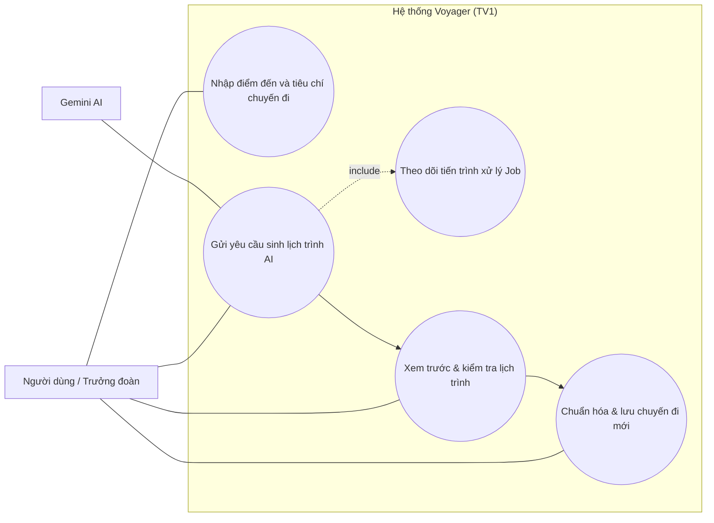

### 1.2. Activity Diagram — TV1

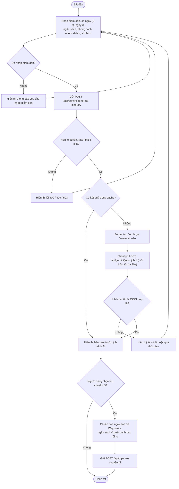

### 1.3. Sequence Diagram — TV1

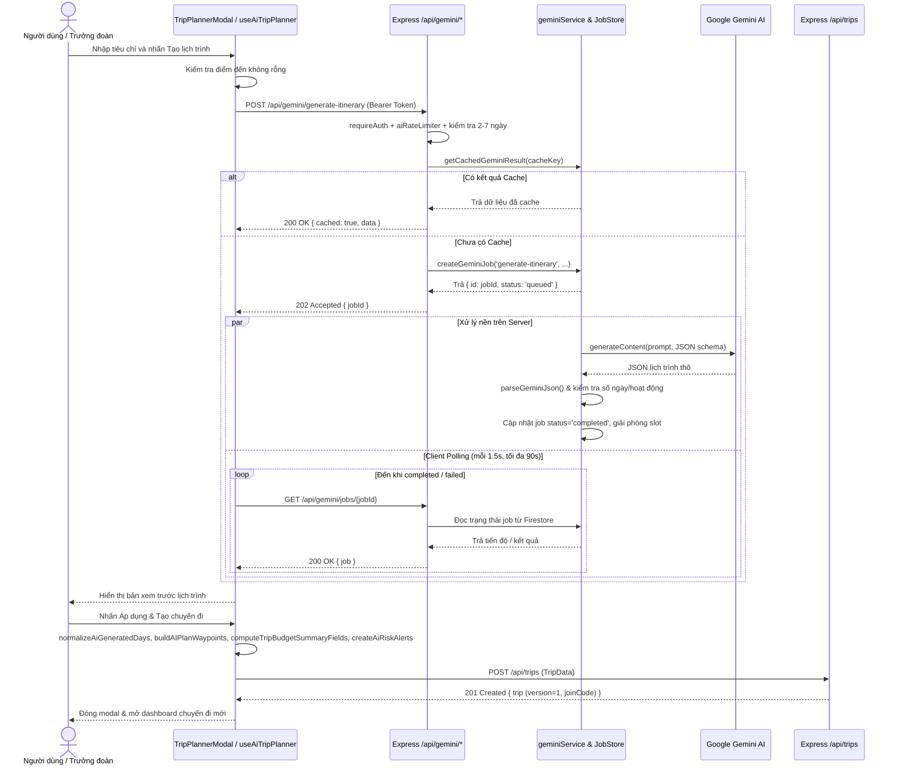

---

## 2. TV2 — Phạm Huy: Tối ưu lịch trình bằng AI (theo yêu cầu)

### 2.1. Đặc tả Use Case (Use Case Specification)

| Thuộc tính | Nội dung chi tiết |
| :--- | :--- |
| **Mã Use Case** | `UC-02` |
| **Tên Use Case** | Tối ưu lịch trình bằng AI (theo yêu cầu) |
| **Người phụ trách** | TV2 — Phạm Huy |
| **Tác nhân chính** | Chủ chuyến đi / Quản trị viên (`Owner`, `Admin`) |
| **Tác nhân phụ** | Gemini AI (`@google/genai`), Bộ kiểm tra khả thi (`scheduleValidator`), Bộ dự phòng quy tắc (`buildRuleBasedScheduleOptimization`) |
| **Mô tả tóm tắt** | Phân tích lịch trình hiện tại, cảnh báo vận hành và mục tiêu tối ưu của người dùng để đưa ra các phương án điều phối lại giờ giấc hợp lý. Mọi phương án do AI sinh ra đều bắt buộc đi qua **bộ kiểm tra khả thi theo quy tắc Admin** trước khi hiển thị bảng so sánh Trước/Sau (Diff) cho người dùng áp dụng hoặc hoàn tác (Undo). |
| **Tiền điều kiện** | - Người dùng đã đăng nhập và là Chủ chuyến đi (`ownerId === uid`) hoặc `Admin`. - Chuyến đi có ít nhất 1 ngày chứa hoạt động (`days`). |
| **Hậu điều kiện** | - Nếu người dùng chọn áp dụng phương án: Lịch trình ngày mục tiêu được cập nhật theo đúng `activityId`, cảnh báo liên quan được gỡ có chọn lọc, lưu snapshot để hỗ trợ Hoàn tác (Undo) và đồng bộ lên server (`PUT /api/trips/{tripId}`). - Nếu hủy hoặc không có phương án đạt chuẩn: Lịch trình gốc giữ nguyên. |
| **Luồng sự kiện chính (Main Flow)** | 1. Người dùng mở modal Tối ưu lịch trình (`AIOptimizeModal`). 2. Modal đóng gói dữ liệu rút gọn của chuyến đi (`compactTrip`), danh sách cảnh báo (`alertDetails`) và `userGoal`, gửi `POST /api/gemini/optimize-schedule`. 3. Server kiểm tra quyền sở hữu/admin (`buildOptimizePayload`), nạp cấu hình quy tắc vận hành (`rules`: khung giờ ngày, buffer tối thiểu, tốc độ di chuyển, kiểm tra chồng giờ/giờ mở cửa/nhận phòng sớm, ưu tiên tránh nắng trưa/người cao tuổi). 4. Server kiểm tra cache; nếu chưa có cache và có `GEMINI_API_KEY`, tạo job nền (`createGeminiJob`) và trả `202 Accepted` kèm `jobId`. 5. Server chạy `runOptimization`: dựng prompt kèm quy tắc bắt buộc (`buildOptimizePrompt`), gọi Gemini AI lấy danh sách đề xuất. 6. **Bộ kiểm tra khả thi (`validateOptimizationResult`)** mô phỏng từng đề xuất lên ngày mục tiêu, loại các đề xuất vi phạm quy tắc cứng (`OVERLAP`, `BUFFER_TOO_SHORT`, `TRANSIT_TOO_SHORT`, `OUT_OF_DAY_WINDOW`, `OUTSIDE_OPENING_HOURS`, `HOTEL_CHECKIN_EARLY`, `COMPLETED_ACTIVITY`) và gắn cảnh báo mềm (`HOT_NOON`, `ELDERLY_LONG_BLOCK`). 7. Client poll `GET /api/gemini/jobs/{jobId}` nhận về `recommendations` đã được lọc và thông tin `validation` (`accepted`, `rejected`). 8. Người dùng xem thẻ đề xuất hoặc chuyển sang chế độ **So sánh Trước / Sau (`computeOptimizationDiff`)**. 9. Người dùng chọn phương án và nhấn **"Áp dụng"**. Client dùng `applyScheduleChangesStrict` (chỉ ghép theo `activityId`), lọc cảnh báo đã xử lý (`filterAlertsByRecommendation`), lưu bản sao hoàn tác (`Undo`) và lưu lên server. |
| **Luồng thay thế (Alternative Flow)** | - **A1 (AI tự sửa 1 lần khi bị loại hết):** Nếu Gemini trả kết quả nhưng `accepted.length === 0 && rejected.length > 0`, server gửi kèm lý do vi phạm (`summarizeRejectionsForRetry`) để AI sửa lại 1 lần duy nhất. - **A2 (Fallback thuần quy tắc khi AI lỗi hoặc thiếu API key):** Nếu `ai === null` hoặc gọi Gemini thất bại, `runOptimization` kích hoạt `buildRuleBasedScheduleOptimization` (xử lý cảnh báo thời tiết/đèo dốc, sửa buffer/overlap, tránh nắng trưa `11:30–13:30`) và vẫn đưa qua `validateOptimizationResult` (`source: 'fallback'`). - **A3 (Hoàn tác / Undo):** Sau khi áp dụng, người dùng có thể nhấn Hoàn tác để khôi phục trạng thái lịch trình trước đó. |
| **Luồng ngoại lệ (Exception Flow)** | - **E1 (Không đủ quyền):** Nếu user không phải chủ chuyến/Admin, server trả `403 Forbidden`. - **E2 (Không có phương án an toàn):** Toàn bộ đề xuất bị bộ kiểm tra loại; client hiển thị lý do bị loại (`validation.rejected`) và không cho áp dụng phương án lỗi. - **E3 (Vượt giới hạn AI / Timeout):** Trả `429` khi vượt rate limit hoặc tối đa 2 job; timeout sau `90 giây`. |
| **Quy tắc nghiệp vụ & Mã nguồn** | - Tuyệt đối không ghép thay đổi theo tên hoạt động — bắt buộc khớp `activityId` chính xác. - Không sửa hoạt động đã `"Hoàn tất"`. - File liên quan: `AIOptimizeModal.tsx`, `scheduleOptimizer.ts`, `scheduleValidator.ts`, `applyOptimization.ts`, `src/server/routes/gemini.ts`, `src/server/services/geminiService.ts`. |

#### Use Case Diagram — TV2

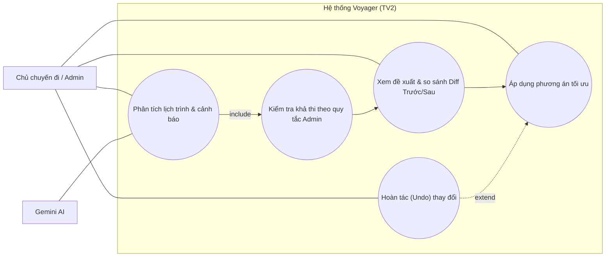

### 2.2. Activity Diagram — TV2

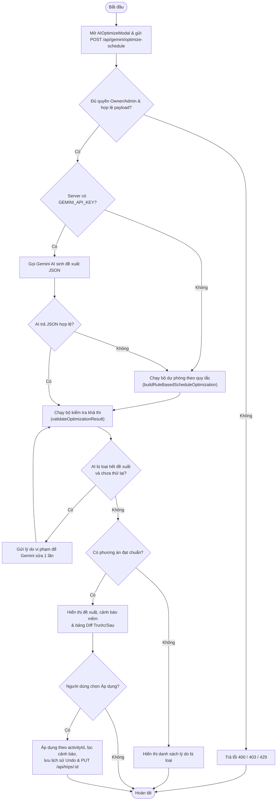

### 2.3. Sequence Diagram — TV2

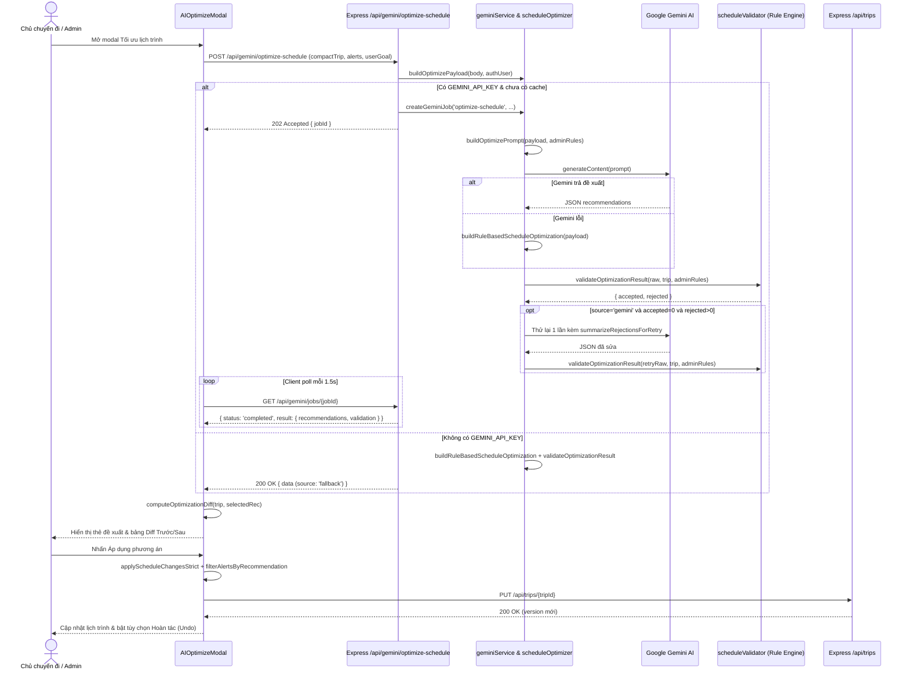

---

## 3. TV3 — Gia Khánh: Quản lý bản đồ và tiến độ lịch trình

### 3.1. Đặc tả Use Case (Use Case Specification)

| Thuộc tính | Nội dung chi tiết |
| :--- | :--- |
| **Mã Use Case** | `UC-03` |
| **Tên Use Case** | Quản lý bản đồ và tiến độ lịch trình |
| **Người phụ trách** | TV3 — Gia Khánh |
| **Tác nhân chính** | Thành viên đoàn (`User`, `Guest` ở chế độ chỉ đọc), Chủ chuyến đi / Quản trị viên (`Owner`, `Admin`) |
| **Tác nhân phụ** | Dịch vụ định tuyến OSRM (`router.project-osrm.org`), Dịch vụ thời tiết Open-Meteo (`api.open-meteo.com`), Bản đồ Leaflet / CARTO |
| **Mô tả tóm tắt** | Hiển thị bản đồ tuyến đường trực quan theo từng ngày hoặc toàn chuyến, tính khoảng cách/thời gian di chuyển thực tế qua OSRM (hoặc ước tính Haversine khi OSRM lỗi), đồng bộ thời tiết dọc tuyến từ Open-Meteo, theo dõi tiến độ theo trạng thái điểm dừng, cho phép cập nhật trạng thái điểm dừng và tối ưu thứ tự lộ trình ngắn nhất (TSP). |
| **Tiền điều kiện** | - Chuyến đi có danh sách ngày/hoạt động hoặc điểm dừng (`waypoints`). - Người dùng đang xem Dashboard người dùng hoặc chế độ Hành khách (`GuestTripView`). |
| **Hậu điều kiện** | - Bản đồ, lộ trình từng chặng, phần trăm tiến độ và thời tiết dọc tuyến được hiển thị chính xác. - Nếu cập nhật trạng thái điểm dừng hoặc áp dụng tối ưu tuyến TSP (với quyền chỉnh sửa): dữ liệu chuyến đi được đồng bộ và lưu lại (`PUT /api/trips/{tripId}`). |
| **Luồng sự kiện chính (Main Flow)** | 1. Người dùng mở tab/khối Bản đồ tuyến đường (`LiveRouteMap`). 2. Hệ thống tổng hợp danh sách điểm dừng và tiến độ (`buildRouteProgress`) theo bộ lọc ngày (`dayFilter`: toàn chuyến hoặc 1 ngày cụ thể). 3. Nếu có từ `2` điểm dừng có tọa độ hợp lệ trở lên và chưa có trong cache, hook `useRoadRouting` gọi `POST /api/routing/road` (hoặc `POST /api/guest/routing/road` nếu là khách). 4. Server gọi OSRM tính khoảng cách thực tế (`distanceKm`), thời gian di chuyển (`durationMinutes`) và hình học tuyến (`geometry`) cho từng chặng, trả về client. 5. Đồng thời, `useLiveRouteControls` gom các điểm có tọa độ (`collectRouteWeatherTargets`) gọi Open-Meteo (`buildBatchOpenMeteoUrl`) để hiển thị thời tiết dọc tuyến (có cache `5 phút` và tự làm mới `10 phút`). 6. `LiveMapCanvas` (Leaflet) vẽ marker điểm dừng theo trạng thái (`completed`, `current`, `upcoming`), vẽ polyline tuyến đường và hiển thị tiến độ ở `LiveMapHeader` & `RouteStopsPanel`. 7. Người dùng có thể lọc theo ngày, chọn điểm dừng để phóng to trên bản đồ, bấm làm mới thời tiết, cập nhật trạng thái hoàn thành của điểm dừng (`applyStopStatusUpdate`), hoặc xem trước/áp dụng tối ưu thứ tự tuyến đường TSP (`optimizeDayActivitiesByRoute` / `optimizeTripByRouteTSP`). |
| **Luồng thay thế (Alternative Flow)** | - **A1 (Chế độ Khách / Hành khách `readOnly`):** Khách xem được bản đồ, tuyến OSRM (`/api/guest/routing/road`), thời tiết và tiến độ, nhưng bị ẩn nút sửa trạng thái điểm dừng và nút tối ưu TSP. - **A2 (Tối ưu lộ trình TSP):** Khi phát hiện thứ tự điểm dừng chưa tối ưu (tiết kiệm `>= 0.5 km`), hiển thị gợi ý TSP; khi chủ chuyến nhấn áp dụng, hệ thống sắp lại hoạt động/waypoints, gọi `fetchRealOsrmRouteSummary` cập nhật `totalKm` và lưu chuyến đi. |
| **Luồng ngoại lệ (Exception Flow)** | - **E1 (OSRM không khả dụng / timeout):** API trả `source: 'fallback'`; `buildRouteProgress` tự tính khoảng cách theo công thức Haversine × hệ số đường bộ và giữ giao diện hoạt động bình thường. - **E2 (Thiếu tọa độ điểm dừng):** Điểm dừng không có tọa độ hợp lệ (hoặc tọa độ hash cũ) được bỏ qua khỏi định tuyến OSRM và hiển thị ghi chú thiếu tọa độ. - **E3 (Lỗi Open-Meteo):** Hiển thị thông báo không tải được thời tiết mới, giữ dữ liệu thời tiết hiện có của chuyến đi. |
| **Quy tắc nghiệp vụ & Mã nguồn** | - Tiến độ lộ trình tính theo trạng thái hoạt động/điểm dừng (không dùng GPS xe trực tiếp). - File liên quan: `LiveRouteMap.tsx`, `LiveMapCanvas.tsx`, `LiveMapHeader.tsx`, `RouteStopsPanel.tsx`, `useLiveRouteMap.ts`, `useRoadRouting.ts`, `useLiveRouteControls.ts`, `routeProgress.ts`, `routeTspOptimizer.ts`, `weatherParser.ts`, `src/server/routes/routing.ts`, `src/server/routes/guest.ts`. |

#### Use Case Diagram — TV3

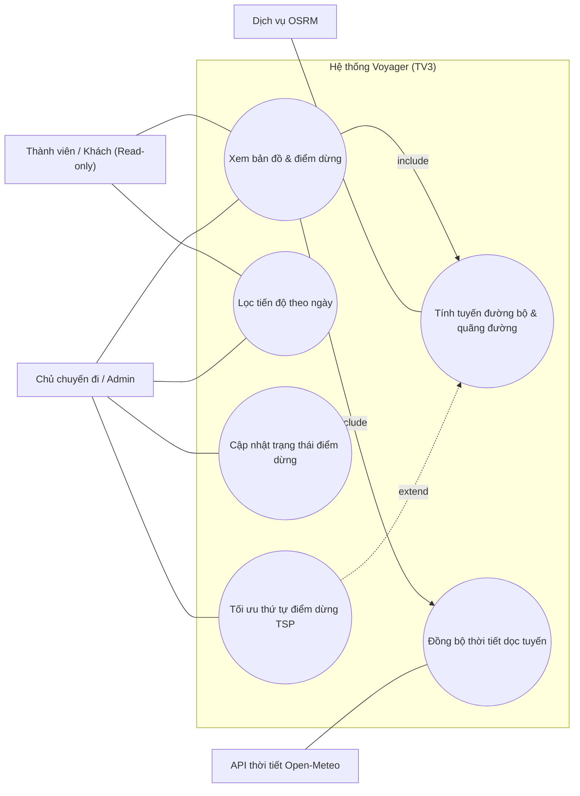

### 3.2. Activity Diagram — TV3

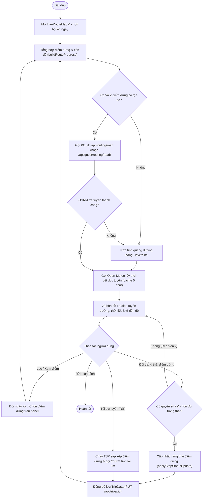

### 3.3. Sequence Diagram — TV3

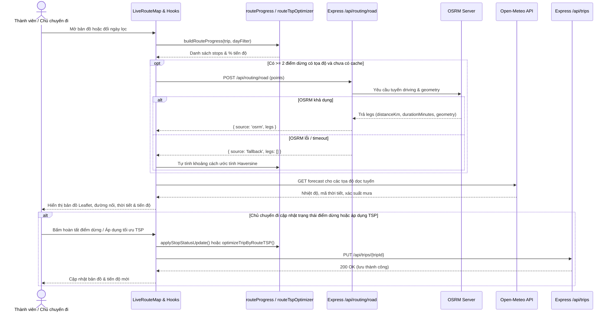

---

## 4. TV4 — Quốc Tuấn: Quản lý thành viên & Điểm danh đoàn du lịch

### 4.1. Đặc tả Use Case (Use Case Specification)

| Thuộc tính | Nội dung chi tiết |
| :--- | :--- |
| **Mã Use Case** | `UC-04` |
| **Tên Use Case** | Quản lý thành viên & Điểm danh đoàn du lịch |
| **Người phụ trách** | TV4 — Quốc Tuấn |
| **Tác nhân chính** | Chủ chuyến đi / Trưởng đoàn (`Owner`, `Admin`), Thành viên có tài khoản (`Participant / HK`), Hành khách không tài khoản (`Guest`) |
| **Tác nhân phụ** | Máy chủ Voyager API, Firestore |
| **Mô tả tóm tắt** | Quản lý danh sách thành viên đoàn (hành khách, hướng dẫn viên, tài xế, người thân đi cùng), tạo/xoay vòng/bật-tắt mã mời tham gia chuyến đi (`joinCode`), hỗ trợ thành viên tham gia bằng mã mời hoặc xem chế độ Hành khách không cần tài khoản, và thực hiện điểm danh trạng thái (`Có mặt`, `Vắng mặt`, `Chưa điểm danh`) có kiểm soát quyền và xung đột phiên bản (`version`). |
| **Tiền điều kiện** | - Đối với quản lý thành viên, mã mời, điểm danh người khác: Người dùng đăng nhập là Chủ chuyến đi hoặc Admin. - Đối với tự điểm danh / thêm người thân đi cùng (`guest-companions`): Người dùng là thành viên đã tham gia chuyến đi (`participantUids`). - Đối với xem lịch trình chế độ Khách: Có `joinCode` hợp lệ (`5–12` ký tự chữ/số) và đang được bật. |
| **Hậu điều kiện** | - Danh sách thành viên, mã mời, số lượng người online/điểm danh (`membersOnline`, `membersTotal`, `membersStatus`) được cập nhật đồng bộ giữa Client và Firestore. - Nếu xóa thành viên có người thân đi cùng, hệ thống xử lý gỡ liên kết/cascade người thân đi kèm. |
| **Luồng sự kiện chính (Main Flow)** | 1. Chủ chuyến đi mở màn hình Thành viên (`MembersView`) để xem bộ lọc (Tất cả / Hành khách / Nhân sự / Khách đi cùng) và thống kê có mặt. 2. **Quản lý hồ sơ thành viên (Owner/Admin):** Thêm, sửa, hoặc xóa thành viên; đồng bộ danh sách qua `PUT /api/trips/{tripId}`. 3. **Quản lý mã mời (`joinCode`):** Chủ chuyến đi tạo mới, xoay mã (`rotate`) hoặc bật/tắt mã mời (`toggle`) qua `POST /api/trips/{tripId}/join-code`. 4. **Tham gia chuyến bằng mã (`JoinTripModal`):** Thành viên khác nhập mã mời → gọi `POST /api/trips/join` → server gán UID vào `participantUids`, thêm bản ghi thành viên `HK` và trả về chuyến đi đã lọc thông tin nhạy cảm (`sanitizeTripForParticipant`). 5. **Thêm người thân đi cùng không cần tài khoản:** Thành viên hoặc chủ chuyến gọi `POST /api/trips/{tripId}/guest-companions` (mỗi hành khách tối đa `MAX_GUEST_COMPANIONS_PER_PASSENGER` người thân). 6. **Điểm danh (`PATCH /api/trips/{tripId}/members/{memberId}/attendance`):**    - Client cập nhật lạc quan (optimistic UI) và gửi kèm `attendanceStatus` + `expectedVersion`.    - Server kiểm tra quyền (Owner/Admin được điểm danh mọi người; Thành viên tự điểm danh bản thân hoặc người thân do mình mời), kiểm tra trạng thái hợp lệ và chạy transaction tăng `version`.    - Server trả về `membersStatus`, `version` mới; client đồng bộ thống kê có mặt. |
| **Luồng thay thế (Alternative Flow)** | - **A1 (Vào bằng mã cho Khách không tài khoản):** Tại `AuthScreen` (tab "Vào bằng mã") hoặc link `?guest=CODE`, khách gửi `POST /api/guest/access`; server trả `GuestTripData` đã ẩn chi phí/UID/SĐT hành khách (`sanitizeTripForGuest`) và lưu phiên vào `localStorage`. - **A2 (Rời chuyến đi):** Thành viên đã tham gia có thể rời chuyến qua `POST /api/trips/{tripId}/leave`. |
| **Luồng ngoại lệ (Exception Flow)** | - **E1 (Xung đột phiên bản `409 Conflict`):** Khi điểm danh hoặc sửa thành viên bị lệch `version` với máy chủ, server trả `409`; client tải snapshot mới nhất và mở `SyncConflictModal` để người dùng chọn giữ bản máy chủ hay ghi đè. - **E2 (Vượt giới hạn thử mã mời):** `joinCodeRateLimiter` chặn khi thử quá `40 lần / 5 phút` (`429`). - **E3 (Mã mời bị khóa hoặc sai):** Trả `403` (mã đã tắt) hoặc `404` (không tìm thấy). - **E4 (Vượt giới hạn người thân / Không đủ quyền):** Trả `400` / `403` và hoàn tác trạng thái lạc quan trên UI. |
| **Quy tắc nghiệp vụ & Mã nguồn** | - Phân quyền chặt chẽ giữa Owner/Admin, Participant (`sanitizeTripForParticipant`), và Guest (`sanitizeTripForGuest`). - File liên quan: `MembersView.tsx`, `JoinTripModal.tsx`, `GuestTripView.tsx`, `useTripActions.ts`, `tripJoinHelpers.ts`, `guestSession.ts`, `src/server/routes/tripManagement.ts`, `src/server/routes/guest.ts`. |

#### Use Case Diagram — TV4

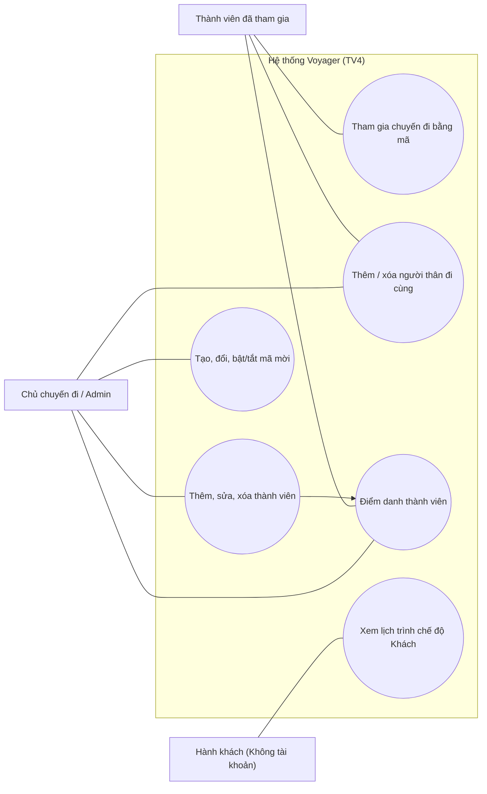

### 4.2. Activity Diagram — TV4

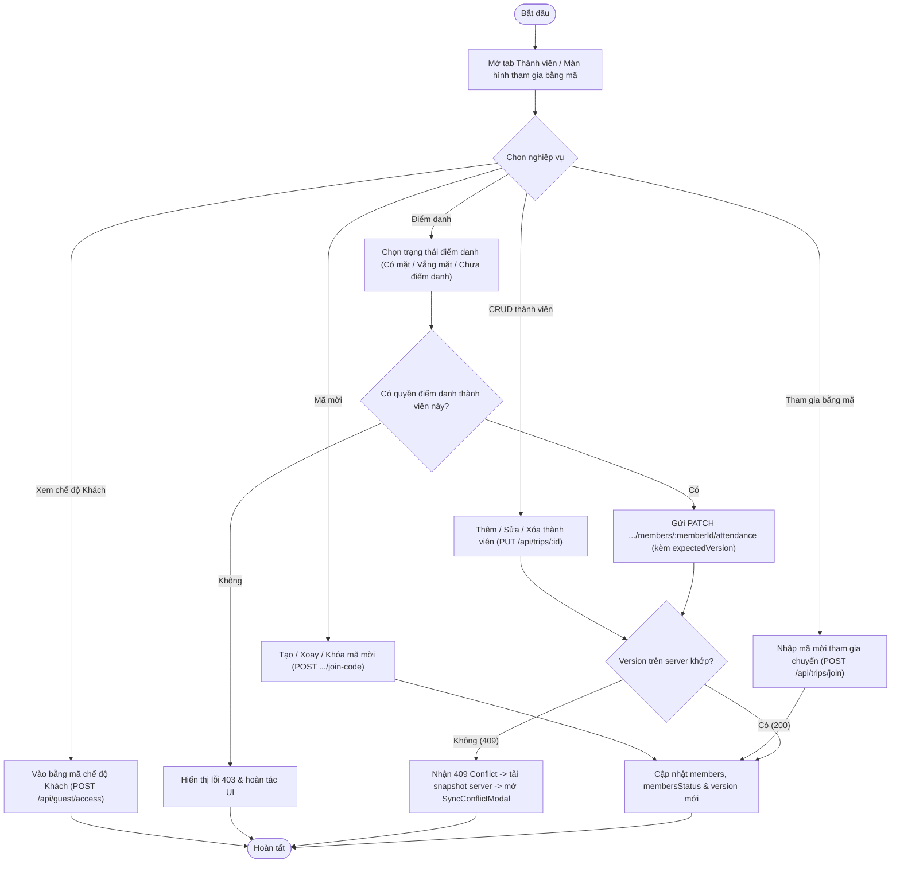

### 4.3. Sequence Diagram — TV4

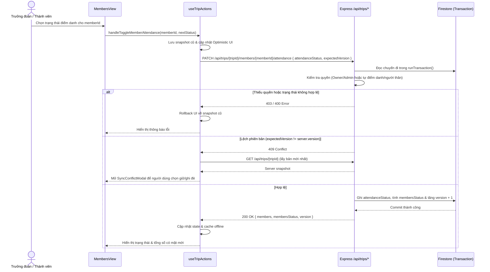

---

## 5. TV5 — Minh Tuấn: Quản lý ngân sách & Ghi nhận hóa đơn chuyến đi

### 5.1. Đặc tả Use Case (Use Case Specification)

| Thuộc tính | Nội dung chi tiết |
| :--- | :--- |
| **Mã Use Case** | `UC-05` |
| **Tên Use Case** | Quản lý ngân sách & Ghi nhận hóa đơn chuyến đi |
| **Người phụ trách** | TV5 — Minh Tuấn |
| **Tác nhân chính** | Chủ chuyến đi / Trưởng đoàn (`Owner`, `Admin`) |
| **Tác nhân phụ** | Máy chủ Voyager API, Firestore (`trips`, `trip_receipts`) |
| **Mô tả tóm tắt** | Cho phép thiết lập tổng ngân sách và phân bổ hạn mức cho 5 hạng mục (Vận chuyển, Lưu trú, Ẩm thực, Tham quan, Dự phòng), ghi nhận/chỉnh sửa/xóa hóa đơn thực tế, liên kết hóa đơn với hoạt động trong lịch trình (tránh tính trùng chi phí), đính kèm ảnh chứng từ có nén tự động, theo dõi cảnh báo vượt hạn mức và xem/xuất báo cáo chi tiêu CSV. |
| **Tiền điều kiện** | - Người dùng đã đăng nhập với quyền chỉnh sửa chuyến đi (`Owner` hoặc `Admin`). - Đã chọn một chuyến đi hợp lệ; nếu thêm hóa đơn mới thì tổng số hóa đơn chưa vượt `MAX_INVOICES_PER_TRIP`. |
| **Hậu điều kiện** | - Ngân sách tổng, phân bổ hạng mục, danh sách hóa đơn (`invoices`), 4 chỉ số tổng hợp (`budgetTotal`, `budgetUsed`, `budgetRemaining`, `budgetUsedPercent`) và các cảnh báo ngân sách (`alert-budget-*`) được tính lại đồng bộ và lưu trên server (hoặc hàng đợi offline nếu mất mạng). - Ảnh chứng từ tách lưu riêng ở collection `trip_receipts` (tối ưu dưới giới hạn 900KB của tài liệu Firestore chuyến đi). |
| **Luồng sự kiện chính (Main Flow)** | 1. Chủ chuyến đi mở tab Ngân sách (`BudgetView`). 2. Hệ thống tính toán số liệu qua `useBudgetCalculations` (`computeBudgetMetrics`): phân tách chi thực tế (hóa đơn + hoạt động `"Hoàn tất"` chưa gắn hóa đơn), chi dự kiến (hoạt động chưa hoàn tất/chưa hủy, bỏ qua hoạt động `"Chờ duyệt"`), và phần trăm từng hạng mục. 3. **Chỉnh sửa ngân sách (`BudgetEditModals`):** Nhập tổng ngân sách hoặc phân bổ chi tiết 5 hạng mục → tính lại 4 trường ngân sách và lưu qua `PUT /api/trips/{tripId}`. 4. **Ghi nhận / sửa hóa đơn (`InvoiceEditorModal` & `useBudgetActions`):**    - Nhập tên khoản chi, số tiền (`> 0`), hạng mục, ngày/chỉ số ngày, nhà cung cấp, số hóa đơn, ghi chú, và có thể chọn hoạt động liên kết (`linkedActivityId`) để tự động điền ngày/hạng mục/chi phí.    - Nếu đính kèm ảnh chứng từ: client kiểm tra định dạng ảnh (`JPG/PNG/WebP`), tự động resize tối đa `800px` và nén JPEG dưới `95–180KB` (`handleReceiptFileChange`).    - Nhấn Lưu: nếu đang trực tuyến và có ảnh mới, client tải ảnh lên `POST /api/trips/{tripId}/receipts` để nhận `receiptId`.    - Tạo/cập nhật bản ghi `ExpenseInvoice`, tính lại `computeTripBudgetSummaryFields`, cập nhật chuyến đi (`PUT /api/trips/{tripId}`).    - Nếu sửa hóa đơn thay ảnh mới, client xóa chứng từ cũ (`DELETE /api/trips/{tripId}/receipts/{oldReceiptId}`). 5. `syncBudgetAlertsIntoTrip` tự động tạo/cập nhật/gỡ cảnh báo khi chi tiêu chạm ngưỡng `>= 85%` hoặc vượt `100%` tổng/hạng mục. 6. Người dùng có thể mở `ExpenseReportModal` để xem tổng hợp hoặc xuất file CSV (`handleExportCsv` → `buildExpenseReportCsv`). |
| **Luồng thay thế (Alternative Flow)** | - **A1 (Ngoại tuyến / Lỗi tải ảnh tạm thời):** Nếu mất mạng khi lưu hóa đơn có ảnh, ảnh nén được giữ tạm dạng `receiptImage` inline trong bản ghi hóa đơn và lưu vào hàng đợi offline (`offlineStorage`); khi đồng bộ lại (`offloadTripReceipts`), hệ thống tự tách ảnh upload lên `trip_receipts`. - **A2 (Xóa hóa đơn):** Xóa hóa đơn khỏi danh sách, tính lại ngân sách và chỉ gọi `DELETE /api/trips/{tripId}/receipts/{receiptId}` sau khi đã lưu chuyến đi thành công (tránh mất ảnh nếu lưu thất bại). |
| **Luồng ngoại lệ (Exception Flow)** | - **E1 (Vượt số lượng hóa đơn tối đa):** Chặn tạo mới khi đạt `MAX_INVOICES_PER_TRIP`. - **E2 (Ảnh quá lớn hoặc sai định dạng):** Báo lỗi nếu không phải tệp ảnh hoặc sau khi nén vẫn `> 180KB`. - **E3 (Chạm giới hạn tài liệu Firestore 900KB):** Server trả `413 Payload Too Large` nếu dữ liệu chuyến đi quá lớn. - **E4 (Xung đột version 409):** Mở `SyncConflictModal` để đối chiếu phiên bản. |
| **Quy tắc nghiệp vụ & Mã nguồn** | - Hoạt động đã liên kết với hóa đơn thực tế (`linkedActivityId`) chỉ tính tiền theo hóa đơn, không cộng trùng. - Hoạt động `"Chờ duyệt"` không tính vào `budgetUsed`. - Ngưỡng cảnh báo sớm: `BUDGET_NEAR_LIMIT_RATIO = 0.85` (85%). - File liên quan: `BudgetView.tsx`, `BudgetSummary.tsx`, `BudgetEditModals.tsx`, `ExpenseLedger.tsx`, `InvoiceEditorModal.tsx`, `ExpenseReportModal.tsx`, `ReceiptImage.tsx`, `useBudgetActions.ts`, `useBudgetCalculations.ts`, `useBudgetSettings.ts`, `budgetAlerts.ts`, `tripSyncHelpers.ts`, `src/server/routes/tripManagement.ts`. |

#### Use Case Diagram — TV5

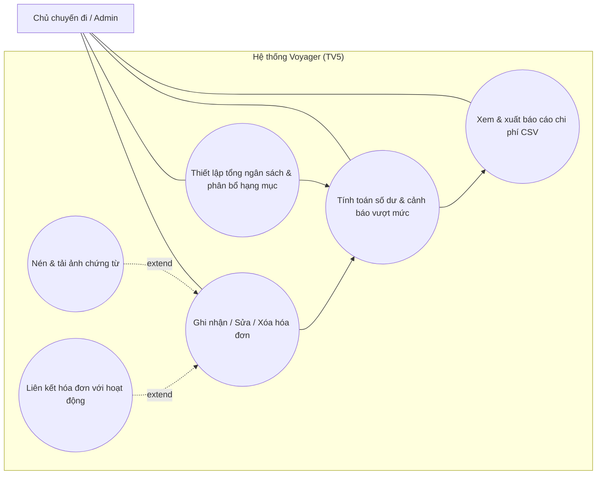

### 5.2. Activity Diagram — TV5

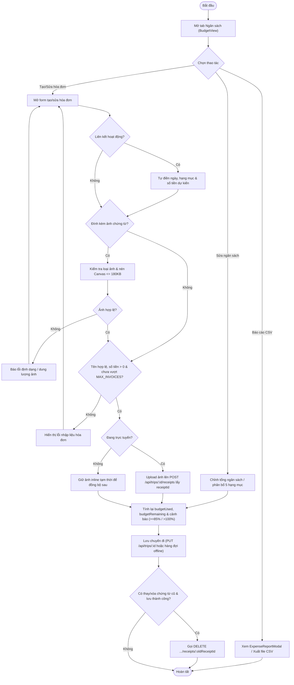

### 5.3. Sequence Diagram — TV5

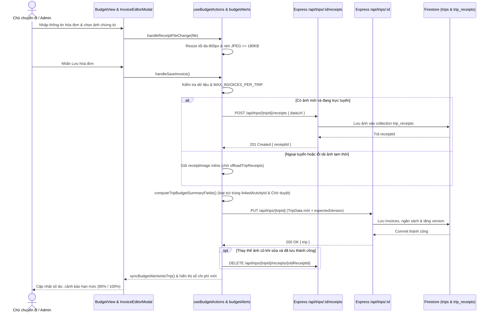
